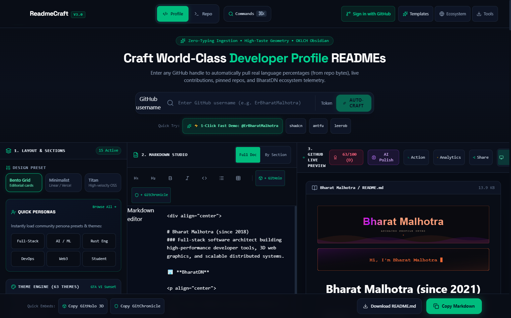
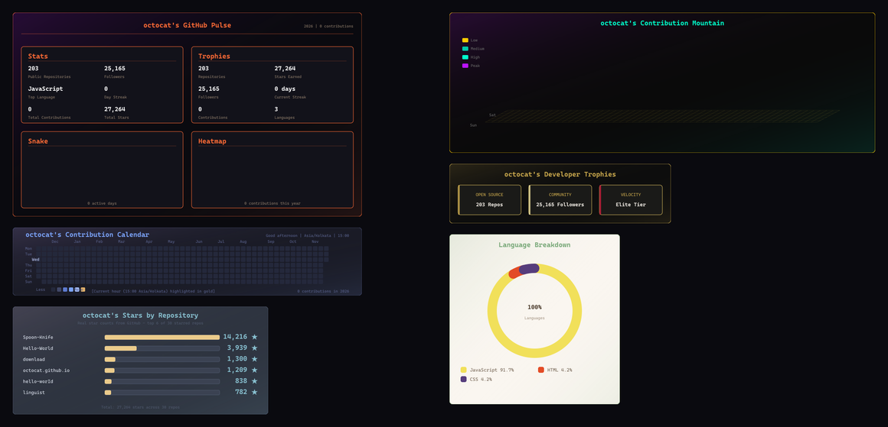

# 🛠️ ReadmeCraft

> **Production:** `https://readme.bharatdn.com`
> **Ecosystem:** `githolo.bharatdn.com` · `gitchronicle.bharatdn.com`
> **Repository:** `ErBharatMalhotra/readmecraft`
> **License:** AGPL-3.0
> **Author:** Bharat Malhotra (`ErBharatMalhotra`)

---

## 🎯 Overview

**ReadmeCraft** is a dual-mode GitHub README Studio for **Developer Profiles** and **Repositories**. Enter a GitHub username or repo URL → get a production-ready README in seconds with real data, native SVG badges, and 1-click ecosystem cross-pollination.

## 📸 Screenshots



<p align="center"><em>Dual-mode studio: section blocks, raw markdown editor and an exact GitHub preview, with 63 themes.</em></p>



<p align="center"><em>41 badge types rendered by our own SVG engine from real GitHub data — stats, streak, heatmap, snake and composite cards fully native.</em></p>

### Key Capabilities

| Feature | Description |
|---------|-------------|
| **Dual-Mode Studio** | Profile READMEs + Repository READMEs in one tool |
| **Zero-Typing Ingestion** | Username → real language bytes, pinned repos, live stats; Repo URL → package.json/Cargo.toml inspection |
| **Presets & Templates** | 3 profile layouts + 16 persona templates (Profile) · Standard, API, CLI (Project) |
| **Native SVG Badges** | 41 badge types via `/api/badges` — stats, streak, heatmap, snake and composite cards rendered in-house, with a 6-hour edge cache |
| **GitHub OAuth** | "Sign in with GitHub" → your personal 5,000 req/hr token used automatically |
| **Star Button** | Native "Star Repo" in header — direct API call, no redirect |
| **🩺 Badge Auditor** | `/audit` — finds dead badges in any profile README and hands back fixed markdown |
| **🚀 Deploy Button** | One-click GitHub App install → auto-pushes README to your profile repo |
| **🧙 Project README Wizard** | `/craft` — analyzes repo, detects type, generates tailored markdown + badges |
| **🎨 Themes System** | 63 themes in 8 categories (gaming, anime, aesthetic, dev classics, cyberpunk, retro, nature, minimal) |
| **🧩 Composite Card** | `?type=composite&include=stats,trophies,snake,heatmap&theme=tokyonight` |
| **Ecosystem Widgets** | 1-click GitHolo 3D Cards + GitChronicle Cadence badges |
| **Export Ready** | Copy Markdown, Download README.md, JSON Import/Export, localStorage persistence |

---

## 🏗️ Architecture

### 3-Pane Studio Layout

```
┌─────────────────┬──────────────────────────┬──────────────────────────┐
│  PANE 1: BLOCKS │      PANE 2: EDITOR      │     PANE 3: PREVIEW      │
│                 │                          │                          │
│ [x] Bio/Header  │  ### Hi, I'm Bharat 👋   │  Hi, I'm Bharat 👋       │
│ [x] Tech Stack  │                          │                          │
│ [x] Pinned Repos│  ```ts                   │  ┌────────────────────┐  │
│ [x] GitHolo Card│  const skills = [..]     │  │ GitHolo 3D Card    │  │
│ [x] GitChronicle│  ```                     │  └────────────────────┘  │
│ [x] Native Badges│                          │  TypeScript · Next.js    │
│                 │                          │                          │
│ [+ Add Section] │  [Monospace Raw Editor]  │  [Exact GitHub Markdown] │
└─────────────────┴──────────────────────────┴──────────────────────────┘
```

### Rate-Limit Survival Strategy (Bulletproof)

| Layer | Implementation |
|-------|----------------|
| **OAuth Priority** | User's personal token (5,000 req/hr) > Server PAT fallback |
| **Unified GraphQL** | Single query (cost: 1) fetches profile, repos, languages, contributions, pinned |
| **Request Deduplication** | 60s in-memory cache prevents duplicate lookups |
| **Edge Caching** | 6-hour TTL + `stale-while-revalidate` on all badge/profile responses |
| **ETag / 304** | `If-None-Match` conditional requests → 0 cost on cache hit |
| **Mock Fallback** | Deterministic telemetry when GitHub API is rate-limited |

---

## 🎨 Design System

| Property | Value |
|----------|-------|
| **Background** | `#090d16` (Deep Obsidian) |
| **Borders** | `#1e293b` (Titanium) |
| **Accent** | `#10b981` (Signal Emerald) |
| **Gold Accent** | `#f59e0b` (Amber) |
| **Display Font** | Space Grotesk |
| **Mono Font** | JetBrains Mono |
| **UI Font** | Verdana / system |

---

## 📦 Native Badge API (`/api/badges`)

Badges are rendered server-side by ReadmeCraft's own SVG engine — **41 badge types** across 8 theme categories (**63 themes**), with no client-side JS. Stats, streak, contribution heatmap, snake, trophies, language charts, the composite card and every **tech-stack chip** are fully native and depend on no third-party image service. Generated READMEs contain **no shields.io URLs at all** — the profile header row (followers / portfolio / social / email), pinned-repo chips, repository-header badges (stars, forks, licence, stack, version) and topic tags are all rendered by this API, and a regression test (`native-badges.test.ts`) fails if a shields.io URL ever comes back.

```
https://readme.bharatdn.com/api/badges?username=<login>&type=<type>&theme=<theme-id>
```

### Profile badges

| Type | Description |
|------|-------------|
| `repos` | Public repository count |
| `followers` / `following` | Follower / following counts |
| `language` | Top language by bytes |
| `streak` | Current contribution streak (days) |
| `contributions` | Total contributions in the last year |
| `stars` | Stars the user has given |
| `blog` | Blog presence badge |
| `skill` | Native tech chip — `&name=React` (curated simple-icons subset) |
| `skill-row` | Row of up to 12 native tech chips — `&skills=React,Docker,Redis` |
| `score` | Taste Score badge — `&value=92&grade=A&label=ReadmeCraft%20Score` |
| `chip` | Generic two-part chip for links — `&label=Portfolio&value=Live` (+ optional `&accent=emerald\|gold\|red`) |

### Visual cards

| Type | Description |
|------|-------------|
| `trophy` | 🏆 Trophy shelf |
| `activity` | 📈 30-day commit activity |
| `heatmap` | 🗓️ 52-week contribution heatmap |
| `snake` | 🐍 Animated contribution snake |
| `star-history` | ⭐ Real star counts per repository (top 6 + total) |
| `repo-card` | 📦 Rich repository card — `&repo=<name>` |
| `language-donut` | 🍩 Language donut |
| `language-race` | 🏁 Animated language race |
| `skill-bubbles` / `skill-radar` | 🫧 Bubble / radar charts |
| `repo-constellation` | ✨ Repository constellation |
| `contribution-flow` | 🌊 Contribution flow |
| `contribution-mountain` | ⛰️ 52-week contribution mountain |
| `code-pulse` | 💓 Live code pulse |
| `code-time-heatmap` | 🕒 Coding-time heatmap |
| `tech-galaxy` | 🌌 Tech-stack galaxy |
| `streak-calendar` | 🔥 Compact streak calendar |
| `visitor` | 👀 Visitor card |

### Operations: badge numbers need a token

GitHub's GraphQL API has no anonymous access, so live numbers (repos, followers, streak, contributions) need a valid `GITHUB_TOKEN`. If the token is missing or revoked, badges render **`n/a`** and `/api/badges` returns `"degraded": true` instead of a confident `0`. The demo calendar cards keep rendering so a broken token never leaves an empty README.

### Badge health check (`/audit`)

```
https://readme.bharatdn.com/audit?u=<login>        # web report
https://readme.bharatdn.com/api/audit?username=<login>   # JSON
```

Reads the profile README and flags what no longer renders:

| Rule | Examples |
|------|----------|
| Dead host | paused `github-readme-stats.vercel.app`, retired `*.herokuapp.com` (streak stats, typing SVG, activity graph), `travis-ci.org` |
| Silent breakage | `github.com/…/actions/workflows/*.yml/badge.svg` after a workflow rename, stale `badge.fury.io` / npm version badges, coverage badges with lapsed upload tokens |
| Third-party risk | shields.io chips, self-hosted readme-stats clones, visitor counters |
| Native | badges already served from `/api/badges` |

Every dead/risky badge gets a mapped native replacement, and the report returns the whole README with the fixes applied. Hosts without a rule are reported as "unchecked" rather than guessed at.
| `typing` | ⌨️ Animated typing SVG |
| `name-banner` | 🏷️ Name banner — `&name=<text>` |
| `ascii` | 🎨 ASCII banner — `&text=<text>` |
| `composite` | 🧩 Multi-badge card (see below) |

### Repository badges

Pass the owner as `username` and the repository as `repo`:

```
?username=owner&repo=name&type=stars
```

| Type | Description |
|------|-------------|
| `stars` | Repository stars |
| `forks` | Forks |
| `issues` | Open issues |
| `license` | SPDX license id |
| `size` | Repository size |
| `last-commit` | Time since last commit |

### Integration badges

Read server-side credentials; show `Token Required` until configured:

| Type | Credential |
|------|------------|
| `spotify` | `SPOTIFY_REFRESH_TOKEN` |
| `youtube` | `YOUTUBE_API_KEY` |
| `wakatime` | `WAKATIME_API_KEY` |
| `leetcode` | `LEETCODE_SESSION` |
| `codeforces` | `&handle=` or `CODEFORCES_HANDLE` |

### 🎨 Themes (63)

Every badge accepts `&theme=<id>`. Unknown ids fall back to `gta6`.

| Category | Themes |
|---|---|
| Gaming | `gta6` `cyberpunk2077` `elden-ring` `witcher3` `hollow-knight` `bloodborne` `minecraft` `valorant` `apex-legends` `league-of-legends` |
| Anime | `tokyonight` `tokyonight-storm` `evangelion` `akira` `ghost-in-shell` `chainsaw-man` `jjk` `demon-slayer` `spy-x-family` `one-piece` `naruto` |
| Aesthetic | `synthwave` `vaporwave` `lofi` `cottagecore` `dark-academia` `y2k` `sunset` `midnight-purple` `space` |
| Dev classics | `dracula` `nord` `gruvbox` `github` `github-light` `monokai` `solarized-dark` `solarized-light` `one-dark` `material-oceanic` `vscode-dark` `catppuccin` `catppuccin-latte` `rose-pine` `rose-pine-dawn` |
| Cyberpunk | `matrix` `tron` `hacker` `amber-terminal` `blade-runner` `ghostrunner` |
| Retro | `gameboy` `nes` `windows95` `winamp` `ms-dos` `c64` |
| Nature | `forest` `ocean` `aurora` |
| Minimal | `minimal-dark` `minimal-light` `high-contrast` |

**Usage:** `https://readme.bharatdn.com/api/badges?username=octocat&type=snake&theme=tokyonight`

### 🧩 Composite Card

One request, several badges:

```
https://readme.bharatdn.com/api/badges?type=composite&username=octocat&include=stats,trophies,snake,heatmap&theme=gta6
```

**Params:**
- `include` — comma-separated: `stats`, `trophies`, `snake`, `heatmap`, `activity`, `language`, `followers`, `repos`
- `theme` — any of the 63 theme ids
- `layout` — `grid` (2×2) or `stack` (vertical)

**Cache-bust:** append `&v=<anything>` (edge cache is 6h)

---

## 🔐 GitHub OAuth Integration

### Setup (Production)

1. **GitHub OAuth App** → Settings → Developer settings → OAuth Apps
2. **Callback URL:** `https://readme.bharatdn.com/api/auth/gh-callback`
3. **Vercel Env Vars:**
   ```
   AUTH_GITHUB_ID=<client_id>
   AUTH_GITHUB_SECRET=<client_secret>
   AUTH_SECRET=<64-char-hex>  # node -e "console.log(require('crypto').randomBytes(32).toString('hex'))"
   GITHUB_TOKEN=<pat>          # fallback for unauthenticated users
   ```

### Flow (Custom — not NextAuth v5)

```
User clicks "Sign in with GitHub"
    ↓
GET /api/auth/signin/github → returns HTML with GitHub OAuth URL
    ↓
GitHub OAuth consent (scopes: read:user read:org repo)
    ↓
Returns to /api/auth/gh-callback → exchanges code for token
    ↓
Creates JWT session token (HS256, 30d expiry)
    ↓
Sets HttpOnly cookie: nextauth.session-token
    ↓
Meta refresh + JS redirect to /
    ↓
Client fetches /api/auth/session → gets user data
```

### Custom Auth Client

We use a **custom auth client** (`src/lib/auth-client.tsx`) instead of NextAuth v5:

```typescript
// useAuth() hook — same API as useSession()
const { session, status, update, signOut } = useAuth();
// status: 'loading' | 'authenticated' | 'unauthenticated'
// session: { user: { id, name, email, image, login }, accessToken, expires }
```

**Why custom?**
- NextAuth v5 broke our custom PKCE + JWT cookie flow
- Vercel edge follows HTTP 302 redirects; auth routes return HTML with meta refresh + JS redirect
- PKCE with state in signed JWT cookie `nextauth.pkce`; session in `nextauth.session-token`

---

## 🚀 One-Click Deploy (GitHub App)

### User Flow

```
1. Sign in with GitHub (OAuth)
   ↓
2. Header shows green 🚀 "Deploy" button (3 locations)
   ↓
3. Click → /deploy page → Select theme + badges
   ↓
4. Click "Deploy to GitHub Profile"
   ↓
5. Redirects to GitHub App install page
   ↓
6. Select username/username (profile repo)
   ↓
7. GitHub App callback → generates README with theme-aware badge URLs
   ↓
8. Pushes README.md to profile repo via installation token
   ↓
9. Done! Profile README live
```

### GitHub App Config

| Property | Value |
|----------|-------|
| **App Name** | ReadmeCraft Deploy |
| **App ID** | 5746827 |
| **Slug** | `readmecraft-deploy` |
| **Permissions** | `contents: write`, `metadata: read` |
| **Callback** | `https://readme.bharatdn.com/api/auth/github-app/callback` |
| **Webhook** | `https://readme.bharatdn.com/api/auth/github-app/webhook` |

### Env Vars Required

```
GITHUB_APP_ID=5746827
GITHUB_APP_CLIENT_ID=<app_client_id>
GITHUB_APP_CLIENT_SECRET=<app_client_secret>
GITHUB_APP_PRIVATE_KEY=<base64_encoded_pem>
```

---

## 🧙 Project README Wizard (`/craft`)

**Analyzes any repo → generates tailored README + badges**

| Step | Action |
|------|--------|
| 1 | Enter repo URL (`github.com/owner/repo`) |
| 2 | Auto-detects: type (Node, Python, Rust, Go, CLI, API, etc.), package.json/Cargo.toml, languages, topics |
| 3 | Picks preset: Standard / API / CLI / Library / Monorepo |
| 4 | Generates: Badge lineup, sections, ecosystem widgets |
| 5 | One-click copy/download + Deploy button |

**Detection logic:**
- `package.json` → Node/TypeScript → checks for `bin`, `main`, `exports` (CLI vs Lib)
- `Cargo.toml` → Rust → `[[bin]]` vs `[[lib]]`
- `go.mod` → Go → `main` package detection
- `pyproject.toml` / `setup.py` → Python → CLI vs Lib
- `Dockerfile` + `docker-compose.yml` → Container/Infra
- GitHub topics → ML/AI, Game, Web, Mobile, etc.

---

## ⭐ Native Star Button

**Header shows "Star Repo" button when authenticated** — one click, direct API call:

```typescript
// POST /api/star
{ "owner": "ErBharatMalhotra", "repo": "readmecraft" }
→ Uses session.accessToken → PUT /user/starred/owner/repo
→ Returns { starred: true, message: "Starred! Thanks ⭐" }
```

**No redirect, no iframe, instant.** Button updates to "Starred ⭐" (emerald, disabled).

---

## 🌐 Ecosystem Cross-Pollination

| Widget | URL | Embed Code |
|--------|-----|------------|
| **GitHolo 3D Card** | `githolo.bharatdn.com` | `[](https://githolo.bharatdn.com)` |
| **GitChronicle Cadence** | `gitchronicle.bharatdn.com` | `[](https://gitchronicle.bharatdn.com)` |

**Sidebar toggles** (Pane 1) enable/disable each widget → auto-generates embed Markdown.

---

## 🔧 Advanced Features

### Viewer-Aware Badges

Badges detect viewer via edge headers (Vercel/Cloudflare):

| Header | Purpose |
|--------|---------|
| `x-vercel-ip-country` | Country for localized greeting |
| `x-forwarded-for` | IP for visitor count |
| `cf-ipcountry` | Cloudflare country |
| `user-agent` | Bot detection |

**Timezone-aware:** Heatmap highlights current day in viewer's timezone; code-pulse badges show localized greeting.

### Text Safety System

All 41 badge generators use comprehensive text handling:

```typescript
// Font metrics → truncation → wrapping → overflow prevention
const { lines, width, height } = measureText(text, fontSize, maxWidth);
// Auto-wraps long text, truncates with ellipsis, prevents clipping
```

### Snake Badge (Platane/snk Compatible)

- Per-segment keyframes: `sn-move-0` … `sn-move-4`
- Serpentines through contribution cells only
- Falls back to demo calendar when GraphQL rate-limited

---

## 🚀 Local Development

```bash
git clone https://github.com/ErBharatMalhotra/readmecraft.git
cd readmecraft
npm install
npm run dev
```

Visit `http://localhost:3000`.

### Environment (`.env.local`)

```env
AUTH_GITHUB_ID=<client_id>
AUTH_GITHUB_SECRET=<client_secret>
AUTH_SECRET=<64-char-hex>
GITHUB_TOKEN=<pat>  # optional, for unauthenticated fallback

# GitHub App (for deploy flow)
GITHUB_APP_ID=5746827
GITHUB_APP_CLIENT_ID=<app_client_id>
GITHUB_APP_CLIENT_SECRET=<app_client_secret>
GITHUB_APP_PRIVATE_KEY=<base64_encoded_pem>
```

---

## 📁 Project Structure

```
src/
├── app/
│   ├── api/
│   │   ├── auth/
│   │   │   ├── signin/github/route.ts      # Returns GitHub OAuth URL (HTML)
│   │   │   ├── gh-callback/route.ts        # OAuth callback → JWT cookie
│   │   │   ├── session/route.ts            # Verifies JWT → returns user
│   │   │   ├── signout/route.ts            # Clears session cookie
│   │   │   └── github-app/
│   │   │       ├── install/route.ts        # GitHub App install URL
│   │   │       └── callback/route.ts       # Installation token → push README
│   │   ├── badges/route.ts                 # Native SVG badge generator (41 types)
│   │   ├── ingest/route.ts                 # GitHub profile/repo ingestion
│   │   └── star/route.ts                   # Star repo via OAuth token
│   ├── deploy/page.tsx                     # Deploy UI (theme + badge picker)
│   ├── craft/page.tsx                      # Project README Wizard
│   ├── layout.tsx                          # Root layout + AuthProvider
│   └── page.tsx                            # Main studio page
├── components/
│   ├── AuthButton.tsx                      # Sign in/out + user avatar
│   ├── AuthProvider.tsx                    # Client-side custom AuthProvider
│   ├── EcosystemWidgets.tsx                # GitHolo/GitChronicle embeds
│   ├── Header.tsx                          # Top bar with star + deploy buttons
│   ├── HeroIngestion.tsx                   # Username/repo input
│   ├── PaneGitHubPreview.tsx               # Live markdown preview
│   ├── PaneMarkdownEditor.tsx              # Raw markdown editor
│   ├── PaneSectionManager.tsx              # Sidebar: presets, toggles, sections
│   └── ExportToolbar.tsx                   # Copy/Download/Confetti
├── lib/
│   ├── auth-client.tsx                     # Custom useAuth hook + AuthContext
│   ├── auth.ts                             # JWT helpers (SignJWT, jwtVerify)
│   ├── github-api.ts                       # GraphQL + caching + ETag + dedup
│   ├── github.ts                           # fetchGitHubProfile / Project
│   ├── generators.ts                       # Section → Markdown compilers
│   ├── emoji.ts                            # Emoji shortcode → unicode
│   ├── themes.ts                           # 63 theme palettes
│   ├── templates.ts                        # Presets + starter sections
│   ├── score.ts                            # Profile scoring
│   ├── analytics.ts                        # Telemetry helpers
│   ├── action-generator.ts                 # GitHub Action scaffolding
│   ├── ai-assistant.ts                     # Writing assistant helpers
│   └── utils.ts                            # cn() helper
└── types/
    └── readmecraft.ts                      # TypeScript interfaces
```

---

## 🧠 Sidebar (Pane 1) — Layout & Sections

| Area | Contents |
|------|----------|
| **Presets** | Bento / Minimalist / Titan (Profile) · Standard / API / CLI (Project) |
| **Ecosystem Card** | GitHolo + GitChronicle toggles with external links |
| **README Blocks** | Draggable, toggleable, deletable sections (checkbox + up/down + trash) |
| **Add Custom** | Modal for custom title + Markdown content |

---

## 📜 License

**AGPL-3.0** © Bharat Malhotra (`ErBharatMalhotra`)

> **Note:** This project is licensed under AGPL-3.0. If you modify ReadmeCraft and offer it as a service (SaaS, hosted tool, API), you MUST provide your modified source code to users under the same license. For commercial/private use without open-sourcing changes, contact `bharat@bharatdn.com`.